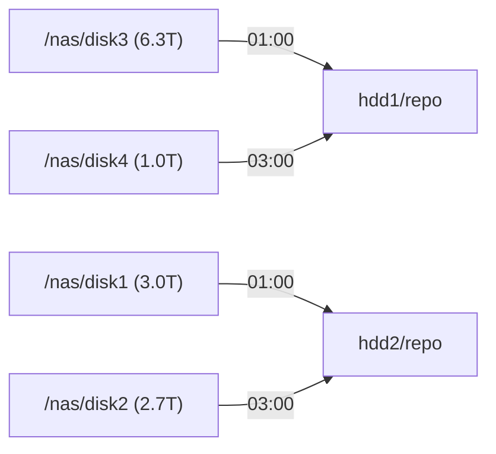

I recently designed and rolled out a backup scheme for an Ubuntu NAS: four NVMe data drives (about 13 TB of data) backed up automatically every day to two 16 TB hard drives. I ended up with **restic** as the backup engine and **Backrest** as the web interface. There were a fair number of architectural trade-offs and real pitfalls along the way, so here is the record.

## Background and goals

The hardware, roughly:

| Part | Spec |
|---|---|
| CPU | 2× Xeon E5 (16 cores, 32 threads) |
| Memory | 32 GB |
| Data drives (SSD) | 3× 4 TB NVMe + 1× 7.68 TB NVMe |
| Backup drives (HDD) | 2× 16 TB enterprise hard drives |

The four data drives are mounted at `/nas/disk1` to `/nas/disk4`, about **13 TB** in total to back up. The largest, a 7 TB drive, is already 96% full.

The goals were clear:

1. Automatic daily backups to the two hard drives.
2. History: a file deleted by mistake can be recovered from a version several days back.
3. **A web UI** to see whether backups succeeded, browse snapshots and restore single files.
4. **Room to grow**: adding an SSD or HDD later must not mean redoing the structure.
5. An alert when a backup fails.

## Choosing the tools

After comparing the options I chose **restic + Backrest**:

- Against plain rsync: a UI, alerts, deduplication and compression to save space, automated retention.
- Against Duplicati, UrBackup and the like: Backrest is a single binary, so it is the cheapest to maintain, and restic has a mature, reliable community.
- The cost: backups are stored in a repository format, so restores go through the UI or the restic command. In the UI it is a matter of clicking, so it isn't much of a burden.

## Overall architecture

### Storage layout: no RAID, two independent file systems

Each hard drive is **one complete, independent file system**. No RAID, no merging into a big volume:

```
/dev/sdb1  →  /backup/hdd1   (14.6T, xfs)
/dev/sdc1  →  /backup/hdd2   (14.6T, xfs)
```

The reasoning:

- **Failure isolation**: if one drive dies, only half the backups are lost and the other half is intact.
- **No one-to-one mapping**: backup jobs are assigned to drives by free space, so a new SSD is just a new job.
- I dropped the earlier layout of two partitions per drive. Splitting brought no benefit and only capped the space available to a single job.

### Assigning backup jobs



| Plan | Source | Size | Repository | Schedule |
|---|---|---|---|---|
| plan-disk3 | /nas/disk3 | 6.3T | /backup/hdd1/repo | daily at 01:00 |
| plan-disk4 | /nas/disk4 | 1.0T | /backup/hdd1/repo | daily at 03:00 |
| plan-disk1 | /nas/disk1 | 3.0T | /backup/hdd2/repo | daily at 01:00 |
| plan-disk2 | /nas/disk2 | 2.7T | /backup/hdd2/repo | daily at 03:00 |

A few points:

- One restic repository per HDD; a repository holds snapshots from several plans.
- **The two plans on the same HDD are staggered** (01:00 and 03:00) so that concurrent writes don't slow a mechanical drive down.
- The two HDDs can run at the same time without affecting each other.
- restic compresses and deduplicates, so actual usage is usually less than the source. The table sizes capacity for the worst case (nothing compressible), and it still fits.

### Retention

One policy everywhere: **the last 7 daily, 4 weekly and 6 monthly snapshots**.

That is, any day in the past week, one version per week within a month, and one per month within half a year. It is set per plan in the Backrest UI, and expired snapshots are pruned automatically.

## Deployment

### Rebuilding the hard drive partitions

Once I had confirmed the old data on both drives was no longer needed, I rebuilt them from scratch (**destructive; check twice before running any of this**):

```bash
# After unmounting the old partitions and removing their entries from /etc/fstab:

# Rebuild the partition table (one whole-disk partition per drive)
parted /dev/sdb -- mklabel gpt mkpart backup xfs 0% 100%
parted /dev/sdc -- mklabel gpt mkpart backup xfs 0% 100%

# Format as xfs (good with large files, supported natively by Ubuntu)
mkfs.xfs -f /dev/sdb1
mkfs.xfs -f /dev/sdc1

# Create mount points and add them to fstab (use UUIDs; device names can move)
mkdir -p /backup/hdd1 /backup/hdd2
blkid /dev/sdb1 /dev/sdc1     # note the two UUIDs

# Append to /etc/fstab (with the real UUIDs):
# UUID=xxxx-xxxx  /backup/hdd1  xfs  defaults,noatime  0 2
# UUID=yyyy-yyyy  /backup/hdd2  xfs  defaults,noatime  0 2

systemctl daemon-reload
mount -a
df -h /backup/hdd1 /backup/hdd2   # each should show about 15T free
```

### Installing Backrest: three pitfalls

This step had the most pitfalls. On a server in mainland China the official install script almost never succeeds on the first try:

1. **Direct connections to GitHub time out**, so the Backrest binary has to come through a mirror.
2. **On startup Backrest downloads restic from GitHub by itself**, which fails the same way. restic has to be installed by hand and its path given through an environment variable.
3. **install.sh runs the service as the current user by default.** To back up every user's files it has to run as root.

The full install:

```bash
# 1. Download Backrest through a mirror (if one fails, try the ghproxy.net / gh-proxy.com prefix)
cd /tmp
URL="https://github.com/garethgeorge/backrest/releases/latest/download/backrest_Linux_x86_64.tar.gz"
wget "https://ghproxy.net/$URL" -O backrest.tar.gz
mkdir -p backrest_extract && tar -xzf backrest.tar.gz -C backrest_extract
cd backrest_extract && sudo ./install.sh

# 2. Install restic by hand (match the version Backrest expects; it is printed in the startup log)
cd /tmp
URL="https://github.com/restic/restic/releases/download/v0.19.1/restic_0.19.1_linux_amd64.bz2"
wget "https://ghproxy.net/$URL" -O restic.bz2
bunzip2 -f restic.bz2 && sudo install -m 755 restic /usr/local/bin/restic
restic version

# 3. Replace the systemd unit: run as root and point at the restic binary
sudo tee /etc/systemd/system/backrest.service > /dev/null <<'UNIT'
[Unit]
Description=Backrest Service
After=network.target

[Service]
Type=simple
User=root
Group=root
ExecStart=/usr/local/bin/backrest
Restart=on-failure
Environment="BACKREST_PORT=127.0.0.1:9898"
Environment="BACKREST_RESTIC_COMMAND=/usr/local/bin/restic"

[Install]
WantedBy=multi-user.target
UNIT
sudo systemctl daemon-reload && sudo systemctl restart backrest

systemctl status backrest
ss -tlnp | grep 9898
```

When running as root, the config file is `/root/.config/backrest/config.json` and runtime data and logs live in `/root/.local/share/backrest/`.

### Reaching the UI: an SSH tunnel

The service listens on `127.0.0.1` only and is not exposed to the network. To use it, open a tunnel from your own machine:

```bash
ssh -L 9898:localhost:9898 user@nas-server
# then open http://localhost:9898 in a browser
```

You could also listen on the LAN address with a UI password (the Backrest setup wizard insists on one), but whatever you do, **never expose the port to the public internet**.

### Repositories and plans

Create the two repositories in the UI (Add Repo). The settings that matter:

| Field | Value |
|---|---|
| Repository URI | /backup/hdd1/repo and /backup/hdd2/repo |
| Env Vars | `RESTIC_READ_CONCURRENCY=8`, `RESTIC_PACK_SIZE=64` |
| Prune Policy | 1st of each month, max unused 10% |
| Check Policy | 1st of each month, structure check |
| Advanced | IO priority = IO_BEST_EFFORT_LOW, CPU priority = CPU_LOW |

**A deliberate trade-off on the repository password.** restic always encrypts and a password is mandatory. But the threat model here is drive failure and accidental deletion; the backup drives sit in the same machine as the sources, so encryption adds no protection. I therefore chose a simple passphrase on purpose and filed it in plain text, reducing the risk of "password lost, all backups useless" to zero. The cost is that if a backup drive leaves the building on its own, anyone who knows the passphrase can read it. That has to be kept in mind before sending a drive for repair or disposing of it.

Then create the four plans (Add Plan) following the table above. plan-disk3, for example:

- Repository: `hdd1`
- Paths: `/nas/disk3`
- Schedule: cron `0 1 * * *`
- Retention: `7 daily / 4 weekly / 6 monthly`

Finally, under Settings → Notifications, set up an alert on backup failure (Email, Discord, Slack and webhooks are supported). Don't skip this. When nobody is watching the UI, failures are buried in silence.

## The first full backup

13 TB at a sustained 150 to 250 MB/s onto the hard drives comes to **about 20 hours**, with the two drives running in parallel.

### What about millions of small files

If the number of small files is huge (millions to tens of millions), per-file overhead adds several hours. Run `df -i /nas/disk*` first to see each drive's inode count (the IUsed column is roughly the file count) so you know what to expect.

Two tuning parameters (set as the repository's Env Vars):

```
RESTIC_READ_CONCURRENCY=8    # default 2; more concurrent reads from the NVMe source, a clear win with small files
RESTIC_PACK_SIZE=64          # pack size from 16M to 64M, fewer files in the repository, kinder to HDDs
```

restic packs small files into large blobs and writes them sequentially to the hard drive, so there is no "one small file at a time, seeking like mad" problem. Incremental backups compare metadata only and never re-read unchanged files, so the slow first run is paid once. And **an interrupted first run is not a disaster**: blobs already in the repository are deduplicated and reused, so re-running is effectively a resume.

### How to run it

- Trigger each plan by hand with **Backup Now** in the UI rather than waiting for the night's schedule.
- Progress is visible live in the UI, and an SSH disconnect doesn't matter because Backrest is a long-running service.
- **Start with the smallest drive (1 TB) alone as a speed benchmark**: from its duration and file count, estimate the other three, and only trigger them once the rate looks right.
- The two plans that share a repository run **one after the other**; different repositories run in parallel.
- Meanwhile watch the NVMe drives' await with `iostat -x 5` to confirm normal use isn't affected.

### Verifying the backup (not optional)

**A backup whose restore has never been tested is not a backup.** After the first full run:

1. Open any snapshot in the UI, browse the file tree, and confirm the directory structure is complete.
2. Pick a few files, Restore them to `/tmp`, and compare sha256 with the originals.
3. Run Prune and Check (restic's integrity check) once on each repository.

I walked through the whole procedure in a test environment first (Tencent Cloud, Ubuntu 24.04, two loop devices standing in for the HDDs): incremental backups finished in seconds, files restored from an old snapshot were byte-for-byte identical to the pre-incident originals, file names with Chinese characters and spaces and symlinks all came back intact, and `restic check` reported no errors on either repository. The three install pitfalls above were all found in that test round.

## Day-to-day operation

**A weekly glance**: are the last runs of all four plans green in the UI, and how is free space on the backup drives trending in `df -h`.

**Adding an SSD**: format and mount it as `/nas/disk5`, Add Plan in the UI pointing at the repository with more free space, schedule it clear of that repository's existing plans, and run the first full backup by hand. Nothing existing is touched; about five minutes of configuration.

**Adding an HDD**: partition, format and mount it as `/backup/hdd3`, Add Repo for a new repository, and point new plans at it. Old repositories and plans stay as they are.

**When space runs low**, in order: tighten retention → prune by hand → add a third HDD.

## Restore cheat sheet

| Situation | What to do |
|---|---|
| A file or directory deleted by mistake | UI → pick a snapshot → browse the tree → Restore |
| A whole SSD failed | Mount the replacement at the original path → Restore the latest snapshot in full |
| The Backrest service is down | The backups are unaffected; use the CLI: `restic -r /backup/hdd1/repo snapshots` |
| The whole server is lost | Plug the hard drives into any Linux machine and restore with restic and the repository password |

## What this scheme does and does not protect against

It is important to be honest about **what this protects against and what it doesn't**.

**Covered**: drive failure, accidental deletion, file system corruption.

**Not covered**: whole-machine disasters. A power fault that fries the drives, ransomware encrypting every mounted volume, fire or flood. The SSDs and the backup HDDs are in the same machine.

If part of the data is irreplaceable, add an off-site layer. restic backs up natively to S3-compatible object storage (Alibaba Cloud OSS, Tencent Cloud COS, Backblaze B2 and others); add a remote repository and a plan in Backrest and the existing structure stays untouched.

I also recommend drive health monitoring alongside: `smartmontools` and `nvme-cli` for write endurance and reallocated sectors, or **Scrutiny** for a web dashboard of SMART health. It complements Backrest: one watches the backups, the other watches the drives.

## Summary

The core trade-offs:

- **No RAID, two independent file systems**: failure isolation in exchange for half the backups always being intact.
- **A deliberately simple repository password**: under this threat model encryption adds nothing, and losing the password is the real risk.
- **Staggered plans on the same drive, parallel across drives**: respect the physics of mechanical disks.
- **Verifying restores is part of the deployment**: an unverified backup is not a backup.

The tools themselves (restic + Backrest) are the least important part. Swap in a different pair and these decisions still hold.
