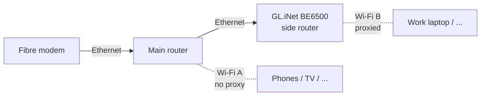

I recently spent some time reworking the network at home. The goal was simple: everyday traffic goes through the main router, and when I need a proxy I switch to the side router's Wi-Fi. Here is the whole setup and the pitfalls along the way.

## Choosing an approach

There are two common ways to proxy a home network:

- **Flash the main router.** All traffic goes through the proxy, but flashing risks bricking the device, and any problem takes the whole household offline.
- **A side router.** A separate device does the proxying while the main router stays untouched. Neither affects the other.

I went with the side router. The main router stays stable and serves the whole family; the side router serves only the devices that need a proxy.

## Topology



It is straightforward:

1. The **fibre modem** dials up (or runs in bridge mode) and feeds the main router.
2. The **main router** handles DHCP and the everyday Wi-Fi (Wi-Fi A) for everyone.
3. The **GL.iNet BE6500** is the side router: its uplink plugs into the main router, and it broadcasts its own Wi-Fi (Wi-Fi B).

The end result is two Wi-Fi networks at home:

| Wi-Fi | Router | Proxy | Used for |
|------|------|------|------|
| Wi-Fi A | Main router | No | Everyday browsing, video, IoT devices |
| Wi-Fi B | GL.iNet BE6500 | Yes | Work, development, research |

Need the proxy? Join Wi-Fi B. Don't? Join Wi-Fi A. Switching costs next to nothing.

## Why the GL.iNet BE6500

While picking a side router I considered a small x86 box (an N100 or similar), but settled on the GL.iNet BE6500:

- **OpenWrt out of the box.** The firmware is a customised OpenWrt, so there is nothing to flash.
- **Enough hardware.** Wi-Fi 7 and a 2.5G port, plenty of headroom for a proxy.
- **Small.** It fits in the network cabinet or on a desk, and unlike a mini PC it doesn't need a separate access point.
- **Built-in Wi-Fi.** The side router broadcasts its own network, which saves buying an AP.

I didn't want to flash firmware or maintain another small computer. An OpenWrt device that works out of the box was exactly right for me.

## Configuration notes

### Main router

The main router barely needs touching. A normal setup is enough:

- DHCP enabled
- WAN port to the fibre modem, one LAN port to the BE6500

### BE6500

GL.iNet's admin panel is friendly, but underneath it is still OpenWrt, and you can open LuCI for finer control:

```bash
# SSH into the BE6500
ssh root@192.168.8.1
```

The settings that matter:

- **WAN port**: connected to the main router's LAN, getting its IP from the main router
- **LAN**: a different subnet (for example `192.168.8.1`) with DHCP enabled
- **Wi-Fi**: set the SSID and password. This is your proxied Wi-Fi
- **Proxy**: configure the proxy tool in OpenWrt so that all traffic from Wi-Fi B goes through it automatically

### DNS

DNS is where things go wrong most easily. The side router's DNS queries have to go through the proxy too, otherwise DNS poisoning will make sites fail to load. Make sure that:

- the BE6500's DNS points at the local resolver provided by the proxy tool
- it does not use the main router's DNS

## Living with it

After a few weeks I'm happy with it:

- **Easy switching.** Phones and laptops just change Wi-Fi; no client software needed.
- **No interference.** The family on Wi-Fi A is completely unaffected, with no drop in speed.
- **Stable.** The BE6500 has run for weeks without a reboot. OpenWrt is dependable.

The only small downside is one more Wi-Fi network in the house, which hardly counts as a problem.

## Summary

If you have a similar need, the side router approach is worth trying. The main router stays as it is, the family's connection is untouched, and using the proxy means switching Wi-Fi. For anyone who doesn't want to flash firmware, the GL.iNet line is a good choice: OpenWrt underneath, with all the extensibility that brings.
